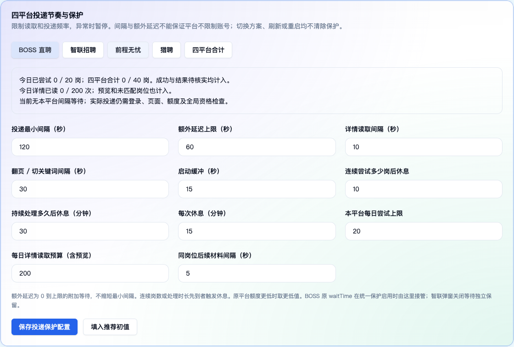

<h1 align="center">🍀 OfferPilot · 求职领航</h1>

<p align="center"><strong>少一些重复操作，多一些求职主动权。</strong></p>
<p align="center">本机运行的多平台求职工具，集中管理筛选条件、投递任务与执行结果。</p>

<div align="center">

[](https://adoptium.net/temurin/releases/?version=21)
[](https://spring.io/projects/spring-boot)
[](https://nextjs.org/)
[](https://react.dev/)
[](LICENSE)
[](https://github.com/slowbuild-lab/offer-pilot/commits/main)

**BOSS 直聘 · 智联招聘 · 前程无忧 · 猎聘**

[特色功能](#features) · [界面预览](#preview) · [快速开始](#quick-start) · [使用指南](本机运行说明.md) · [更新记录](CHANGELOG.md) · [问题反馈](https://github.com/slowbuild-lab/offer-pilot/issues)

</div>

---

## 🧭 项目介绍

工作忙、没时间反复打开招聘网站，希望把精力留给岗位判断和面试准备。OfferPilot 把日常求职整理成一条可查看、可暂停的操作流程：

**设置条件 → 预览岗位 → 确认方案 → 启动任务 → 核对结果。**

你负责确认求职方向、登录账号和处理平台验证；工具负责执行重复操作、控制投递节奏，并记录处理过程。配置与账本保存在本机，平台浏览器会话分别管理。

> **当前使用方式：手动启动任务后，由工具按规则执行。** 每日定时投递、飞书业务通知和完整无人值守恢复尚未实现，见下方[开发计划](#roadmap)。

<a id="features"></a>

## 🌟 特色功能

- **🖥️ 一个首页管理求职任务**：查看平台状态、登录情况、任务占用、可用预算和最近任务，分别启动、停止平台任务。
- **📝 求职方案先预览再生效**：保存版本草稿，先只读采集候选岗位，核对条件与材料后确认。BOSS 与智联使用已确认方案，运行中的任务绑定对应版本。
- **🔎 BOSS 精细筛选**：公司白名单、工作内容包含/排除、可选 HR 冷却期；展开查看命中词、规则原因和岗位原文，便于判断为什么通过或跳过。
- **⏱️ 四平台共用节奏保护**：分别约束详情读取、翻页和实际外发；设置平台间隔、全局间隔、连续休息和每日预算，等待状态持久化保存。
- **📒 投递记录可核对**：区分候选筛选、外发尝试、页面确认与结果待核实；遇到不明确的结果暂停处理，保留记录，不自动重发。
- **🌐 平台会话相互独立**：各平台使用独立浏览器资料和执行线程，默认最多运行两个平台任务；实际外发动作仍按全局规则排队。
- **🛑 异常暂停与人工恢复**：识别登录失效、平台验证、频繁操作和关键请求异常。查看平台页面、处理问题后，再从环境配置解除保护暂停。

功能细节与适配限制见[当前功能说明](ENHANCEMENTS.md)。

<a id="preview"></a>

## 🖼️ 界面预览

### 四平台投递节奏与保护

平台间隔、连续休息、每日预算和剩余次数集中展示，开始任务前即可核对。



<details>
<summary><strong>展开查看：四平台外发保护记录</strong></summary>

查看工具发起的外发尝试和待核实结果。原平台账本与公共保护记录可能对应同一次动作，统计时不要相加。


</details>

截图来自 2026-10-29 的本机只读验收，展示的是配置与空记录界面，不代表真实投递结果。

## 🌐 平台适配

### BOSS 直聘

支持统一求职方案、公司与工作内容筛选、原因明细、可选 HR 冷却期，以及沟通、文字和图片动作记录。启用工作内容筛选但无法取得详情时跳过；启用 HR 冷却但无法识别 HR 时也不放行。

### 智联招聘

支持统一求职方案、新版岗位卡片与详情、滚动加载、原任务额度和结果确认。成功弹窗等待独立保留，不能替代公共投递间隔。

### 前程无忧

使用平台独立配置，按单岗勾选与提交。必须可靠识别岗位、勾选状态和单岗结果；无法确认时暂停，不退回整页批量投递。

### 猎聘

使用平台独立配置。将“聊一聊”点击视为可能的外发起点，以当前卡片沟通状态变化作为确认依据；只打开或关闭聊天窗口不算成功。

四个平台均有隔离页面执行验证记录；真实账号、网站页面变体及后续改版仍需验证。当前支持范围不包含拉勾。

<a id="quick-start"></a>

## 🚀 快速开始

### 1. 准备运行环境

- **JDK 21**。
- **Node.js 24**，包含 npm。
- **Google Chrome** 和可显示浏览器的桌面环境。
- Git；Gradle 使用仓库自带的 Wrapper，无需单独安装。

当前已验证环境为 macOS。Windows 可使用对应 Gradle 命令，其他系统需自行验证。

### 2. 获取代码并安装前端依赖

```bash
git clone https://github.com/slowbuild-lab/offer-pilot.git
cd offer-pilot
cd front
npm ci
cd ..
```

### 3. 准备数据库（首次安装必做）

项目需要兼容的基础数据库，目标路径为：

```text
offer-pilot/
└── db/
    └── getjobs.db
```

当前仓库不附带个人数据库，也没有自己的 Release 数据库安装包。新安装请先按[数据库准备说明](本机运行说明.md#首次运行前数据库)取得兼容、无个人数据的模板；历史模板入口见[来源说明](NOTICE.md#数据库模板)。**新建空 SQLite 文件无法替代基础数据库。**

已有安装保留原数据库，升级时不要用空模板覆盖配置、登录态和记录。

### 4. 启动服务

macOS 可双击 `start-local.command`，或在项目根目录执行：

```bash
./start-local.command
```

手动启动：

```bash
./gradlew --console=plain bootRun --args='--server.address=127.0.0.1'
```

Windows 对应命令：

```powershell
.\gradlew.bat --console=plain bootRun --args="--server.address=127.0.0.1"
```

首次启动会联网准备依赖和浏览器驱动，静态文件不存在时会尝试构建前端。完整安装、打包及排错步骤见[本机运行与升级](本机运行说明.md)。

### 5. 打开管理页并开始使用

- **管理页面**：<http://127.0.0.1:6866/>
- **后端与备用页面**：<http://127.0.0.1:9527/>
- **健康检查**：<http://127.0.0.1:9527/api/health>

1. 打开需要使用的平台浏览器，完成登录。
2. 在“求职方案”保存草稿、预览并确认，供 BOSS 与智联使用；前程无忧和猎聘在各自页面配置。
3. 到“环境配置 → 四平台投递节奏与保护”核对间隔、休息和预算。
4. 手动启动平台任务，从首页观察进度，在“投递记录与额度”核对结果。
5. 出现保护暂停时先检查平台页面与待核实记录，处理完成后解除暂停，再手动启动。

启动服务不会自动开始投递；确认方案也不会创建每日计划。

## ⏱️ 默认投递节奏

<details>
<summary><strong>展开查看：间隔、连续休息与每日预算</strong></summary>

- **平台投递间隔**：最少 120 秒，另加 0–60 秒等待。
- **全局投递间隔**：四平台新投递至少错开 30 秒，同一时间只执行一组外发动作。
- **读取与翻页**：详情读取至少间隔 10 秒，翻页或切换关键词至少间隔 30 秒。
- **连续休息**：连续尝试 10 岗，或持续处理 30 分钟，休息 15 分钟。
- **每日投递预算**：每平台最多 20 岗，四平台合计最多 40 岗。
- **每日读取预算**：详情 200 次/平台，列表操作 50 次/平台；预览读取也计入。

原平台额度、任务上限和页面限制更严格时，继续取更严格的限制。结果待核实会占用尝试次数，不能通过刷新或重启清空保护状态。

这些数值是工具的默认配置，不是平台公布的安全阈值，不能保证账号不受限制。

</details>

## 🤖 AI 与通知

项目保留模型和企业微信配置入口，以及原有 BOSS AI 相关代码。**当前统一方案会关闭旧 BOSS AI 与重复沟通设置**，不能把这些入口视为已接入统一方案的能力。

飞书业务通知、每日投递结果推送仍在开发计划中。模型与通知的现有接入范围见[配置说明](docs/guide/ai-and-push.md)。

<a id="roadmap"></a>

## 🗺️ 开发计划

- [x] 本机管理页面与平台独立会话。
- [x] BOSS / 智联版本化求职方案与只读预览。
- [x] BOSS 精细筛选、规则原因及可选 HR 冷却期。
- [x] 四平台持久化节奏、预算、连续休息与异常暂停。
- [x] 投递账本、公共保护记录与待核实结果。
- [ ] 每日时间窗口与定时执行。
- [ ] 飞书提醒与每日结果汇总。
- [ ] 完整无人值守恢复流程。

## 🛠️ 开发与验证

后端使用 Java 21、Spring Boot 与 SQLite，管理页面使用 Next.js、React 和 TypeScript，浏览器执行基于 Playwright Java 与 Patchright 驱动。

```text
front/                 管理页面
src/main/java/         后端接口、方案、账本与平台执行器
src/main/resources/    应用配置与静态资源
src/test/java/         后端及隔离浏览器测试
docs/                  VitePress 文档与验收记录
tasks/                 实施记录
```

运行检查、重建页面与打包：

```bash
./gradlew test
cd front
npx tsc --noEmit
npm run build -- --webpack
node scripts/copy-dist.mjs
cd ..
./gradlew bootJar
```

修改前端后需完成静态文件复制，再打包后端；否则已有静态产物可能让 Gradle 跳过前端重建，页面仍显示旧版本。

2026-10-29 的项目更名验证包含 **104 项后端测试通过，0 失败、0 错误、0 跳过**，以及前端类型检查、前端构建和文档构建。浏览器测试使用隔离 Chrome，不包含真实简历投递；运行测试前需准备相应浏览器和驱动。

[四平台交付验收](docs/four-platform-pacing-acceptance-20261029.md) · [BOSS 筛选验收](docs/boss-helper-first-batch-acceptance-20261028.md) · [完整功能说明](ENHANCEMENTS.md)

## ❓ 常见问题

<details>
<summary><strong>页面打不开，或修改后仍显示旧页面？</strong></summary>

先检查 6866 / 9527 端口与 `/api/health`。若出现旧页面，核对前端是否重新构建、复制，后端是否打包并运行了新版本。缺表或下拉选项为空时，先检查基础数据库，避免删库重试。

</details>

<details>
<summary><strong>能每天自动投递并通知我吗？</strong></summary>

目前需要手动启动任务，每日定时与飞书业务通知尚未完成。运行时需要电脑保持开机联网，登录失效、验证码和平台限制仍需人工处理。

</details>

<details>
<summary><strong>升级和备份需要保留哪些数据？</strong></summary>

保留 `db/`、`browser-data/` 和 `data/boss/resume/`。SQLite 使用 WAL，服务运行时应使用 SQLite 备份功能；或正常停止服务后备份整个数据库目录，不能只复制运行中的 `.db` 主文件。

Cookie、密钥、浏览器资料、简历和个人数据库仅在本机保留，不提交到仓库。

</details>

<details>
<summary><strong>停止任务能撤回已经发出的申请吗？</strong></summary>

不能。停止只影响后续执行；已发申请需要按招聘平台的实际能力处理。手机或其他工具中的人工投递也不一定被本机额度统计。

</details>

## 🤝 反馈与贡献

欢迎通过 [Issues](https://github.com/slowbuild-lab/offer-pilot/issues)反馈问题，附上系统、提交版本、操作步骤和脱敏日志。提交代码与验证要求见[贡献指南](CONTRIBUTING.md)。

## 📄 来源与许可证

OfferPilot 基于 [loks666/get_jobs](https://github.com/loks666/get_jobs) 持续开发，BOSS 筛选与节奏设计曾参考 [Ocyss/boss-helper](https://github.com/Ocyss/boss-helper)。感谢这些项目提供的基础与参考。

项目沿用 [PolyForm Noncommercial 1.0.0](LICENSE) 及原有附加说明。更名与独立建仓不改变已有代码的授权范围，分发时需保留许可证和 Required Notice，详见[项目来源与授权说明](NOTICE.md)。
